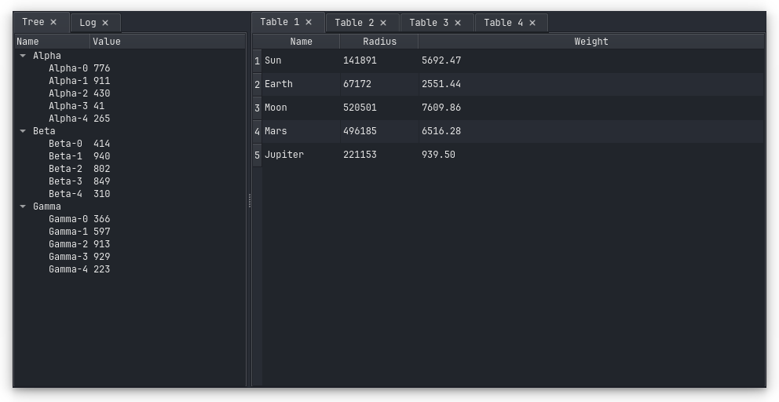

# qt-dock-window

[](https://pypi.org/project/qt-dock-window/)
[](https://github.com/beatreichenbach/qt-dock-window/blob/main/LICENSE)
[](https://github.com/astral-sh/ruff)
[](https://github.com/astral-sh/ty)

A modular, dockable window for Qt.
The layout is a tree of nested splitters and tabs of QWidgets.
Tabs can be dragged between docks, dropped on an edge to split, or detached into floating windows.

The full layout can be serialized and restored.

This package uses Material Icons from [qt-material-icons](https://github.com/beatreichenbach/qt-material-icons).



## Usage

```python
from PySide6 import QtWidgets

from qt_dock_window import (
    DockWidgetState,
    StateDockWindow,
    TabState,
    WindowState,
)


class MyWidget(QtWidgets.QWidget):
    ...


app = QtWidgets.QApplication()

window = StateDockWindow()
window.register_widget(MyWidget, 'My Widget')

window.set_window_state(
    WindowState(
        states=(
            DockWidgetState(
                widgets=(TabState('My Widget', 'MyWidget'),),
                is_center_widget=True,
            ),
        )
    )
)

window.show()
app.exec()
```

For a complete example see the [examples](examples) directory.

## Contributing

To contribute please refer to the [Contributing Guide](CONTRIBUTING.md).

## License

Copyright 2026 - Beat Reichenbach.
See the [License file](LICENSE) for details.
